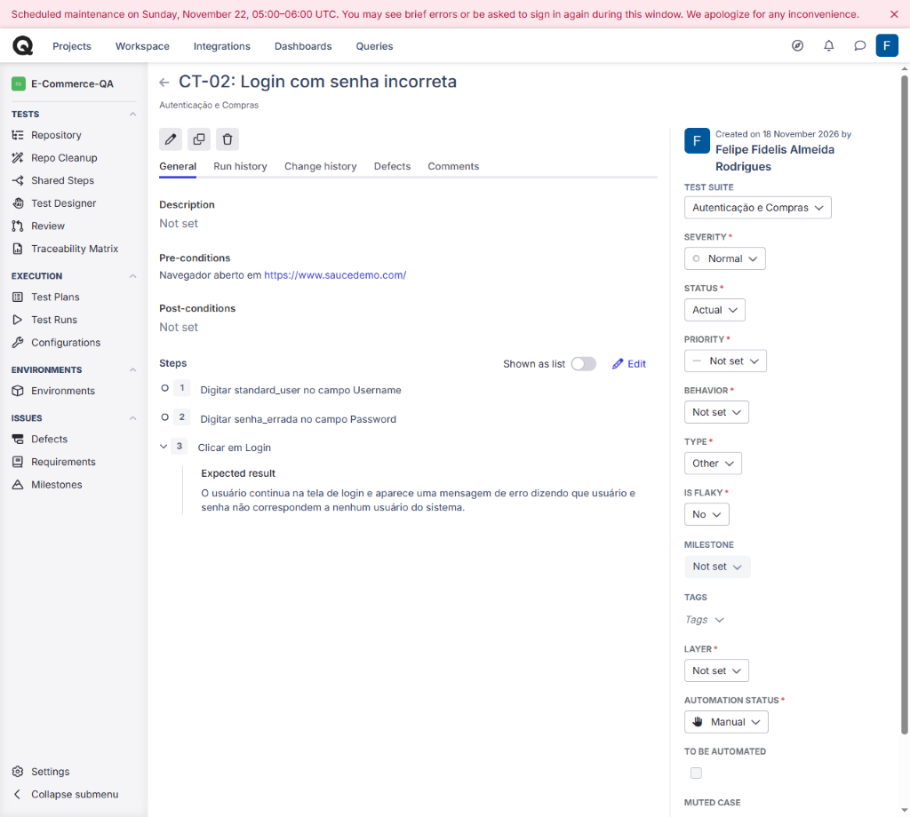
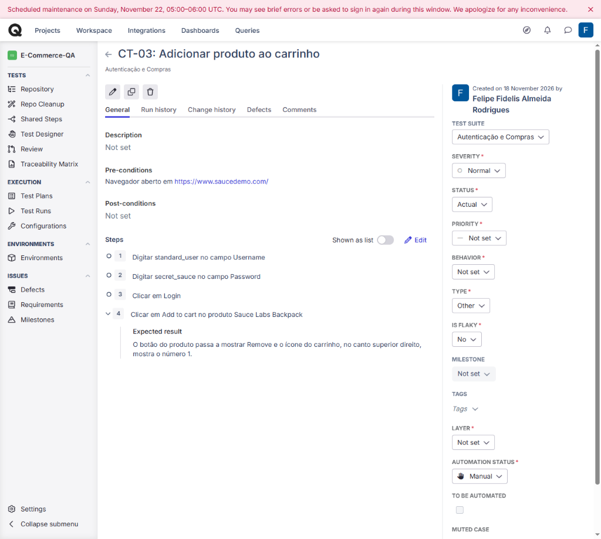
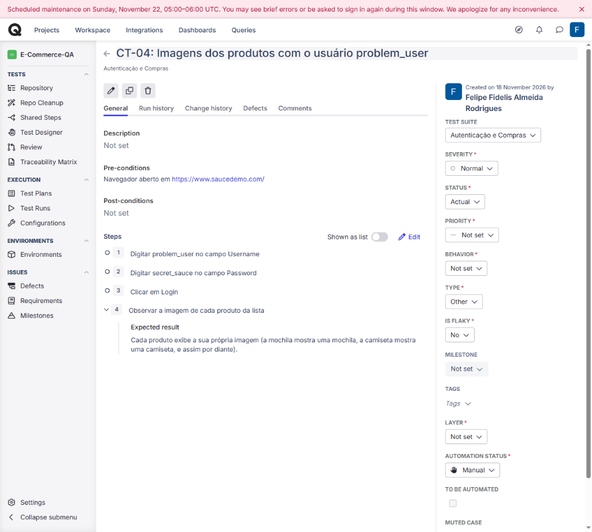
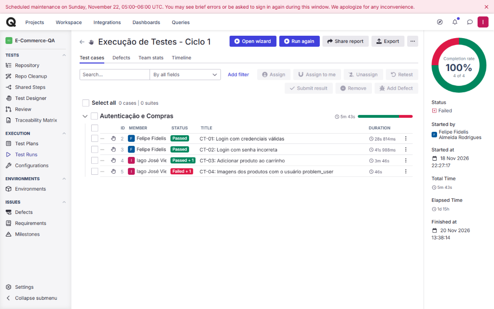

# Atividade: Primeiro Teste de Software

**Estudantes:** Felipe Fidelis Almeida Rodrigues e Iago José Vieira de Araujo
**Curso e período:** Bacharelado em Sistemas de Informação, 8º período
**Disciplina:** Teste de Software

## Sistema testado
SauceDemo (https://www.saucedemo.com/)

## Classificação do teste realizado
- **Nível: sistema.** Testamos a loja inteira pelo navegador, do jeito que um cliente a usa, e não partes isoladas.
- **Objetivo: funcional.** Verificamos se a loja faz o que deveria (login, carrinho, imagens), sem medir velocidade, carga ou segurança.
- **Visão do código: caixa-preta.** Não tivemos acesso ao código; avaliamos apenas as telas e os resultados exibidos.
- **Execução: dinâmico.** O sistema foi executado de verdade durante os testes.
- **Modo: manual.** Nós mesmos executamos cada passo e comparamos o resultado com o esperado, sem script.
- **Motivo: teste novo.** Foi a primeira execução dos casos; se fossem repetidos após uma mudança na loja, passariam a ser teste de regressão.

## Casos de teste

## Execução

## Defeito encontrado
https://github.com/FelipeFidelisA/relatorio-de-bugs-lab/issues/1

## Respostas às perguntas para refletir
1. Porque o resultado esperado deve vir da lógica do sistema, e não do que aparece na tela. Se olharmos o sistema primeiro, tendemos a aceitar o que ele faz como correto. No CT-04, por exemplo, quem já tivesse visto o cachorro em todos os produtos poderia achar que aquilo era normal; como escrevemos antes que cada produto deveria ter a própria imagem, o defeito ficou evidente.

2. O caso de teste é o roteiro planejado antes da execução: diz o que verificar, os passos e o resultado esperado, e pode ser reutilizado em toda nova execução. A issue é o relatório de um problema concreto que aconteceu: traz o resultado obtido, o ambiente, a severidade, a prioridade e a evidência, para que quem vai corrigir consiga reproduzir o erro. Precisamos dos dois porque um diz *como verificar* e o outro diz *o que deu errado*; ligados, permitem saber qual teste encontrou o defeito e, depois da correção, qual teste rodar de novo para confirmar.

3. Não. Os testes mostram que defeitos existem, mas não provam que não existem. Os quatro casos cobriram só uma pequena parte da loja (login, um item no carrinho e as imagens de um usuário). Ficaram de fora o checkout, a ordenação, a remoção de itens, os outros usuários de treino, outros navegadores e telas de celular, entre outros pontos onde pode haver defeitos.

4. Seguindo a estratégia baseada em risco, testaríamos primeiro o fluxo de compra completo, porque envolve dinheiro: checkout com campos obrigatórios vazios, cálculo do subtotal, do imposto e do total, e a finalização do pedido. Depois, a ordenação de produtos, a remoção de itens do carrinho, o login com `locked_out_user` e se o carrinho se mantém após logout. Também automatizaríamos esses casos para rodá-los como teste de regressão a cada nova versão.

5. A resposta da pergunta 5 está na seção "Classificação do teste realizado".

6. Não é teste unitário porque não tivemos acesso ao código nem testamos uma função ou parte isolada; testamos a loja inteira pela interface, como um cliente. Não é teste de carga porque havia apenas um usuário acessando por vez, e não avaliamos o comportamento do sistema com muitos acessos simultâneos nem medimos tempos de resposta.
